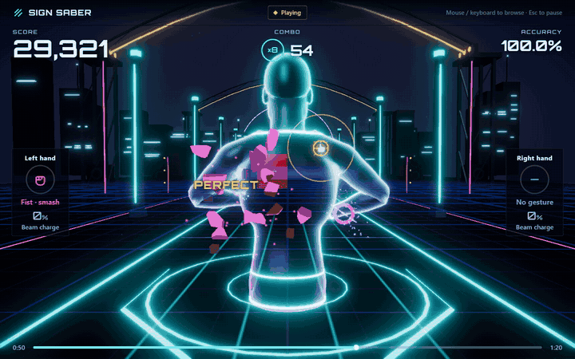
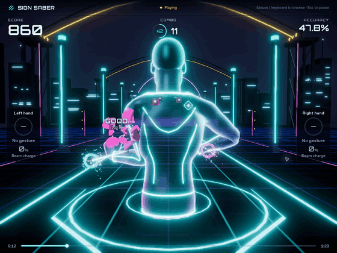
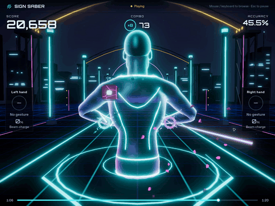
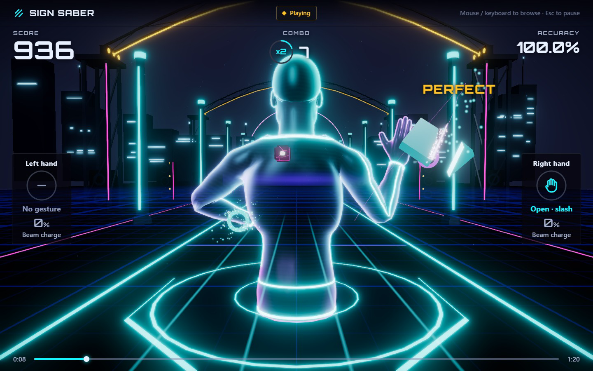
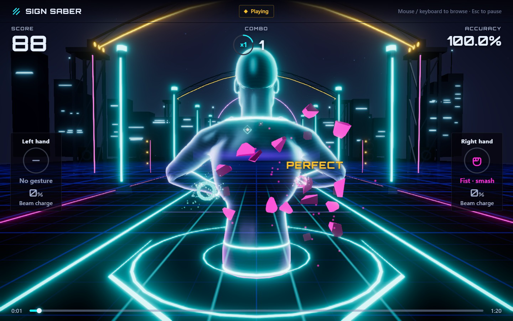
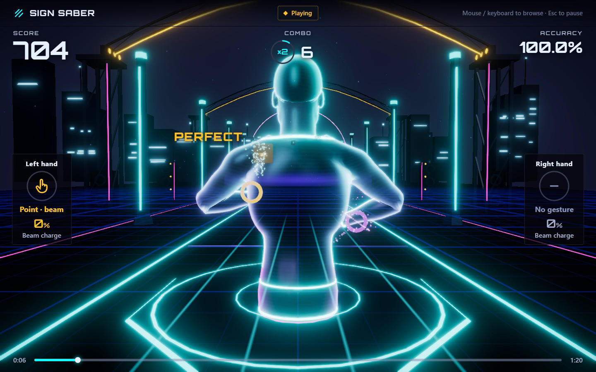
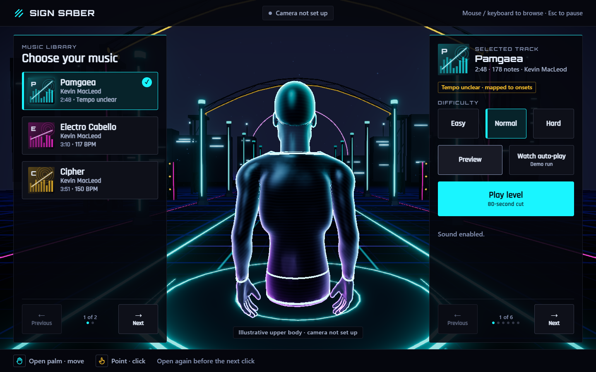
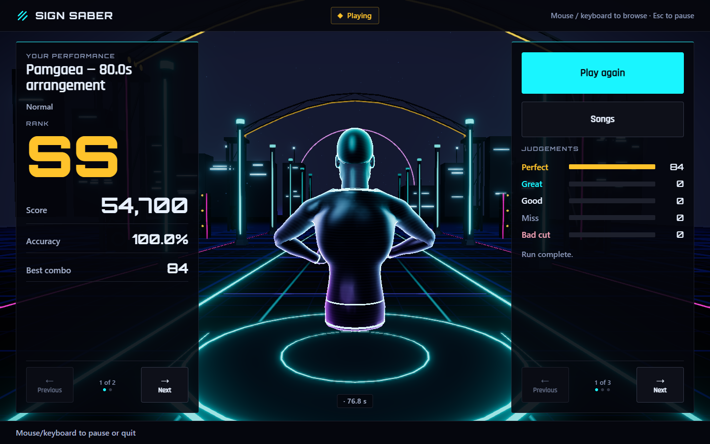
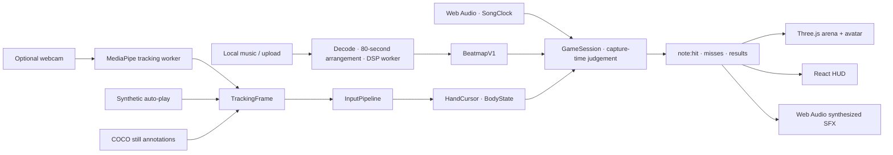

<div align="center">

# Sign Saber

### Your upper body is the controller. The music builds the arena.

**Slice cyan blades. Crush magenta cubes. Fire at gold orbs. Lean into the rhythm.**

[](https://github.com/JunaidAhamed-7777/sign-saber/actions/workflows/ci.yml)
[](LICENSE)
[](app/package.json)
[](app/src/render/renderer.ts)
[](app/src/tracking/tracking.worker.ts)



*Actual browser capture · synthetic auto-play through the real scoring rules · no webcam input.*

**481 tests · 9 full charts · 1,643 Perfect replay hits · 28 original SFX**

[Quick start](#quick-start) · [See the mechanics](#the-arena) · [Measured numbers](#numbers) · [Architecture](#how-it-works) · [Roadmap](#roadmap)

</div>

Sign Saber is an experimental browser rhythm game built with **TypeScript, React, Three.js and MediaPipe**. A rigged holographic avatar stands inside a neon arena, seen from behind. Open palms become blades, fists break fractured cubes, and a held point charges a beam. Music analysis generates the chart; Web Audio drives the clock and synthesizes the effects.

<table>
  <tr>
    <td width="50%"></td>
    <td width="50%"></td>
  </tr>
  <tr>
    <td><strong>Open palm → slice.</strong> A fast stroke cuts the target along the swing plane.</td>
    <td><strong>Point + hold → beam.</strong> Charge, aim and fire at distant gold orbs.</td>
  </tr>
</table>

*Both clips are real application footage of synthetic auto-play, not camera recognition. All screenshots and GIFs on this page were captured from the running game; none are mock-ups or generated images. [Capture details](docs/media/README.md).*

## Try it today

**Watch auto-play is the showcase mode.** A chart-planned performer moves the avatar's hands through the same input pipeline and contact-based judge used by the game. Slashes, smashes, beams, combos and results come from actual scored events.

**Play level is the dataset trial.** It runs an 80-second arrangement using [real COCO upper-body annotations](app/public/assets/fixtures/coco-upper-body-trial.json). These independent still poses contain no hand-gesture labels or recorded swings, so notes register as misses by design.

The optional webcam path uses MediaPipe. Camera integration is currently paused; a consenting person's calibrated, scored webcam session is still an open milestone. The `training/` research model is separate and is **not used by the game**.

## Quick start

Use **Node.js 22 or newer** and a current Chrome or Edge. After cloning and installing dependencies, the bundled demo needs no webcam, account or model download.

```powershell
git clone https://github.com/JunaidAhamed-7777/sign-saber.git
cd sign-saber/app
npm ci
npm run dev
```

Open [localhost:5173](http://localhost:5173):

1. Pick **Pamgaea**, **Electro Cabello** or **Cipher**, then Easy, Normal or Hard.
2. Click **Enable sound** with your mouse or keyboard.
3. Click **Watch auto-play**. The app prepares its 80-second cut and a fresh chart, then performs it.
4. **Esc / Space** pauses. **Resume** continues, **Quit to music** returns to the menu, and **Play again** restarts from results.

For a production preview, run inside `app/`:

```powershell
npm run build
npm run preview
```

Open [127.0.0.1:4173](http://127.0.0.1:4173). Music, charts, fonts and authored geometry are served locally. The prepared server applies a same-origin Content Security Policy and supports audio range requests. A full disconnected venue drill remains a release task.

<details>
<summary><strong>Troubleshooting and optional camera setup</strong></summary>

- **No sound:** click Enable sound again and check the Settings volume. Browsers require a native user action to unlock audio.
- **Port 5173 is busy:** stop the existing server or use the production preview. The development server uses a fixed port.
- **A track fails to load:** choose its Retry track action; the other songs stay available.
- **Optional camera assets:** from `app/`, run `npm run models`, then `npm run build`. Settings exposes setup and positioning preview; live Start requires matching calibration and fresh tracking. Keep head, shoulders, hands and hips visible. Raw webcam pixels stay local.
- **Dataset camera testing:** from the root, `node scripts/prepare-dataset-camera.mjs --coco training/data/coco2017` prepares local, ignored photos. The `?camera=dataset` testing route streams them through MediaPipe. It is separate from the annotation-based Play level mode; see the [camera trial and its limits](docs/evidence/2026-10-25-dataset-camera-trial.md).

</details>

## The arena

<table>
  <tr>
    <td width="33%"><br><strong>Slice</strong><br>Thin cyan slabs, swing-plane cuts, glowing caps and blade ribbons.</td>
    <td width="33%"><br><strong>Smash</strong><br>Cracked magenta cubes burst into their authored fracture pieces.</td>
    <td width="33%"><br><strong>Beam</strong><br>Aim feedback, charge cues and a distinct orb-collapse effect.</td>
  </tr>
</table>

<table>
  <tr>
    <td width="50%"><br><strong>A stage for the performer</strong><br>Local songs, three difficulties and mouse/keyboard navigation around a clear central avatar.</td>
    <td width="50%"><br><strong>Every hit has an outcome</strong><br>Score, accuracy, combo and gesture breakdown come from the completed session.</td>
  </tr>
</table>

*Gameplay and results images show synthetic auto-play. The menu avatar is illustrative.*

Beyond the targets: audio-reactive lighting, bloom, pooled sparks, original sound design and Calm visuals. The avatar ends at the hips throughout menu, play, pause and results.

## Controls and gestures

These are the implemented gesture rules. Auto-play supplies synthetic hands; webcam recognition and human comfort still need live validation.

| Input | Action | Target / feedback |
| --- | --- | --- |
| Open palm + fast swipe | Slice | Cyan blade slab; the swing determines the cut plane |
| Fist + punch | Smash | Magenta cracked cube; fragments follow the fracture mesh |
| Point + hold for 500 ms | Charge and fire a beam | Distant gold orb; aim and charge feedback |
| Lean sideways | Dodge | Move your torso clear of the wall |
| Open palm, then deliberate point | Move and confirm in menus | Optional calibrated hand navigation |
| Mouse / Tab / Enter | Navigate app controls | Song, difficulty, sound, settings and run actions |
| Esc / Space during play | Pause | Resume or Quit to music |
| Esc from pause/results | Return to Songs | Leave the current run |
| Enter on results | Retry | Unless a focused button handles the key |

## Numbers

Measured at application source **`30572bb9cdbe345b79e8e48279019bd7d8b59877`** on 2026-10-25. [Raw verification receipt](docs/evidence/2026-10-25-readme-metrics.json) records commands, environment and exact values. Replay, dataset inference and research results have different scopes.

| Evidence | Result | What it establishes |
| --- | --- | --- |
| Automated application checks | **481 tests · 55 files** | Typecheck, lint, asserted tests and production build via `npm run check` |
| Full bundled-chart performer replay | **1,643 / 1,643 Perfect hits · 9 / 9 charts** | Synthetic hands through the real input pipeline and judge; zero bad cuts or collisions across 129 walls |
| Original sound design | **28 synthesized SFX**, each with a Calm variant | 56 deterministic full/Calm renders pinned by PCM hashes; no recorded SFX |
| Arena and target geometry | **7 GLBs · 5,996 triangles · 352,056 bytes** | Authored pack, excluding the avatar |
| Holographic avatar | **43 bones · 15,134 triangles · 507,252 bytes** | Separate rigged upper-body asset |
| Production JavaScript entry | **1,373,350 bytes raw · 412,107 bytes gzip** | Fresh production build; gzip level 9, excluding other chunks/assets; large-chunk warning remains |
| Short arrangements | **10 s fade in + 60 s highlight + 10 s fade out** | A new WAV and new chart from the edited audio; original songs remain available |
| Dataset-camera pose detection | **24 / 24 COCO photos** | Each photo detected in ≥50% of its attributed frames through the live pipeline; still-photo evidence |
| Dataset-camera joint error | **0.118 shoulder widths** | Median of per-photo mean labelled-joint errors in the recorded sweep |
| Research model, held-out PCK@0.2 | **0.3337 · 3,776 people** | Partial COCO + MPII training, with ground-truth person crops; not the runtime tracker |

The [performer tests](app/tests/performer.test.mjs) replay all nine full charts at 30 Hz through `InputPipeline` and `GameSession`, checking contact, timing, bad cuts and wall hits. The regression requires at least 98% of hits inside the ±60 ms Perfect window on each chart; this run achieved 100% Perfect. These synthetic logic results do not measure webcam accuracy, physical latency or human playability.

### Chart density and gesture mix

Run `node scripts/chart-report.mjs` from the root to inspect every installed chart. Generator v4 budgets each hand's recovery, spaces gesture changes and leaves room around walls.

| Difficulty | Measured notes / second across the three songs | On-screen cap |
| --- | --- | --- |
| Easy | 0.48–0.61 | 3 |
| Normal | 0.84–1.06 | 4 |
| Hard | 1.15–1.47 | 5 |

Across all nine maps: **812 slices · 716 smashes · 115 beams · 129 walls**, with **zero unplayable notes** reported by the planner. Densities above are displayed to two decimal places; the receipt retains exact values. Electro Cabello and Cipher use confident beat tracking; Pamgaea retains its disclosed onset-only fallback. See the [music registry](app/public/assets/tracks/README.md) for per-chart counts, hashes and analysis provenance. Independent music annotations and player comfort checks remain open.

## How it works



**Capture time decides the score.** Each sample is judged once against the audio clock; visual prediction cannot create a hit. `game/` stays independent of Three.js. Renderers, HUD and SFX consume events, while menu actions pass through the state machine. Application-owned hot-path buffers and effects are pooled, and the camera pipeline keeps bounded work in flight.

**Your music stays local.** Upload, decode, analysis and chart generation run in the browser. The arrangement selects one continuous energy/onset-supported highlight with fades; it does not claim to identify a chorus. Bundled audio and charts carry integrity hashes. Read the [architecture contracts](docs/02-architecture.md) and [scoring rules](docs/07-hit-detection-and-scoring.md).

For deeper implementation detail, browse [the specification index](docs/README.md), [design context](DESIGN.md) and [contributor guide](AGENTS.md).

## Tech stack

| Layer | Tools |
| --- | --- |
| App | TypeScript · React 19 · Zustand · Vite |
| Arena | Three.js · WebGL · postprocessing · GLSL |
| Tracking | MediaPipe Tasks Vision · Web Workers · local WASM/models |
| Music | Web Audio · local DSP/FFT analysis · generated beatmaps |
| Sound | Deterministic procedural PCM synthesis · original full/Calm recipes |
| Assets | Blender-authored GLBs · skinned upper-body avatar · local OFL fonts |
| Verification | Vitest · ESLint · TypeScript · Node test runner · browser evidence harnesses |
| Research only | PyTorch · MobileNetV3-Small · ONNX · COCO + MPII |

## Project structure

```text
app/src/
  audio/        Playback clock, arrangements, synthesis and audio analysis
  beatmap/      DSP, chart assignment, validation and caching
  core/         Contracts, constants, state machine and runtime
  game/         Framework-independent contact, judgement and scoring
  gestures/     Open/fist/point classification, blades and hand navigation
  performer/    Chart choreography and synthetic TrackingFrame generation
  tracking/     Camera, MediaPipe worker, filters and input pipeline
  render/       Arena, avatar retargeting, cuts, shards and effects
  ui/           React menu, HUD, pause and results
app/public/     Local music, charts, fonts, fixtures and GLBs
app/tests/      Asserted logic, integration and asset suites
assets-src/     Blender sources and synthesized-audio receipts
docs/           Numbered specifications, evidence and real demo media
scripts/        Content tools, asset checks and browser harnesses
training/       Separate pose-model research; no game runtime dependency
server/         Optional companion stub; outside the working core
```

## Development and verification

Inside `app/`:

```powershell
npm run check
npm run beatmaps
```

`check` runs typecheck → lint → Vitest → production build. `beatmaps` regenerates and validates bundled charts using the shared DSP; it requires ffmpeg. Generated, hash-pinned chart files should only change deliberately. `npm run music` and `npm run fonts` verify/reacquire the pinned source assets when needed.

From the repository root:

```powershell
node --test scripts/check-docs.test.mjs
node scripts/check-docs.mjs
node --test scripts/serve.test.mjs
node --test scripts/check-model-assets.test.mjs
node --test scripts/prepare-dataset-camera.test.mjs
node scripts/check-model-assets.mjs
node scripts/chart-report.mjs
node scripts/render-sfx.mjs --check
node scripts/check-audio-resampling.mjs
node scripts/check-audio-resampling.mjs --arrangement
```

The numeric browser-audio harness needs Chrome (or `BROWSER_BINARY`) and ffmpeg. It checks audio/map correctness, separately from audible sync or webcam evidence. Capture commands and media provenance are in [docs/media](docs/media/README.md).

## Roadmap

- [x] Local three-song library, nine generated difficulty charts and fresh 80-second arrangements.
- [x] Slice, smash, beam and lean judgement; scores, combos, pause/retry and results.
- [x] Rigged holographic avatar, distinct target families, authored arena and synthesized SFX.
- [x] Synthetic auto-play through the real input and scoring pipeline.
- [x] Dataset photos exercised through the live MediaPipe path, with retained failures and source labels.
- [ ] Consenting live-webcam calibration, scored hits and complete gesture/menu trials.
- [ ] Independent music-quality evaluation, comfort, accessibility and flashing review.
- [ ] Repeatable performance measurements, resource soak and disconnected venue drill.
- [ ] Tested release, demo recording and submission details.

These are implementation checkpoints; **P0–P5 release gates remain open**. The [roadmap](ROADMAP.md) owns acceptance order, [HANDOFF.md](HANDOFF.md) records the latest working direction, and [the evidence protocol](docs/24-benchmark-and-evidence.md) defines what a release claim needs. No measured FPS or motion-to-photon claim is made.

### Pose-model research

The separate `training/` pipeline trained a 13-joint upper-body model on COCO and MPII. Its partial CPU run stopped at **1,800 of 7,210 planned steps**. Held-out pooled PCK@0.2 was **0.3337** using ground-truth crops; wrists/elbows remain too weak for gameplay, and there is no integrated detector or browser runtime. ONNX parity checks numerical export, not tracking accuracy. **The game uses MediaPipe.** [Training status and limitations](training/STATUS.md).

## Credits and licenses

**Code, original geometry and synthesized sound effects:** [MIT](LICENSE). All 28 SFX are generated from original code, with no third-party recordings; [recipes and measured receipts](assets-src/audio/sfx-receipt.json).

**Music:** “Pamgaea”, “Electro Cabello” and “Cipher” — Kevin MacLeod ([incompetech.com](https://incompetech.com/)), licensed under [Creative Commons Attribution 4.0](https://creativecommons.org/licenses/by/4.0/). Original bundled MP3s are unchanged. In-app arrangements select a continuous excerpt and apply fades; screenshots/GIFs contain no audio. [Full per-track credits, sources and changes](app/public/assets/tracks/README.md).

**Fonts:** Orbitron and Rajdhani, [SIL Open Font License 1.1; retained notices](app/public/assets/fonts/README.md).

**Data and models:** [COCO annotation attribution](app/public/assets/fixtures/ATTRIBUTION.txt), [research dataset rights](training/DATASETS.json), and [MediaPipe preparation](app/public/models/README.md). Raw research photos and weights stay local/ignored. MPII research restrictions do not become an MIT asset license.

Built on [Three.js](https://github.com/mrdoob/three.js), [React](https://github.com/facebook/react), [Zustand](https://github.com/pmndrs/zustand), [Vite](https://github.com/vitejs/vite), [postprocessing](https://github.com/pmndrs/postprocessing) and [MediaPipe](https://github.com/google-ai-edge/mediapipe). Runtime dependency licenses remain their own; local asset notices travel with the build.

## Submission

This is an experimental project, not a declared P5 release. The screenshots and GIFs demonstrate synthetic auto-play. No release tag, final release SHA, event rules, actual team roster, submission channel or public deployment is asserted. [CHANGELOG.md](CHANGELOG.md) records tested checkpoints and limitations; [AI_USAGE.md](AI_USAGE.md) records AI contributions. The [demo protocol](docs/20-demo-and-judging.md) and [release checklist](docs/19-build-plan.md#release-checklist) define the remaining work.
