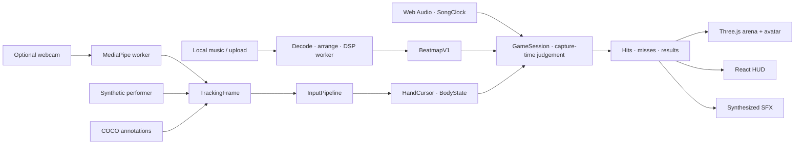

<div align="center">

# Sign Saber

### Your upper body is the controller. The music builds the arena.

**Slice cyan blades. Crush magenta cubes. Fire at gold orbs. Lean into the rhythm.**

[](https://github.com/JunaidAhamed-7777/sign-saber/actions/workflows/ci.yml)
[](LICENSE)
[](app/package.json)
[](app/src/render/renderer.ts)
[](app/src/tracking/tracking.worker.ts)


**8 songs · 24 charts · 4,447 replay hits · 569 passing tests · 28 original SFX**

*Real browser footage. Synthetic auto-play uses the game's input pipeline and scoring rules.*

[Play locally](#quick-start) · [Enter the arena](#the-arena) · [See the proof](#numbers) · [Under the hood](#how-it-works) · [Track 4 submission](#submission)

</div>

Sign Saber turns music into upper-body rhythm combat. A rigged holographic avatar stands inside an authored neon arena. Sweep through cyan slabs, break magenta cubes, charge gold beams and lean around incoming walls. Your movement becomes the performance; every contact feeds the score, combo, sound and destruction.

Choose from **25 minutes of credited local music**, or bring your own audio. The browser builds an **80-second arrangement**—a 10-second fade in, 60-second highlight and 10-second fade out—and generates a new chart from those exact edited samples. Music analysis, playback, rendering and optional camera tracking run locally.

## Choose your track


**Music on the left. Your next move on the right. You in the centre.** Eight full songs, three difficulties, explicit preview and large shared controls surround the upper-body stage. The new geometric sleeves, quieter track rows and restrained cyan actions give the arena its own control booth.

**Watch auto-play** is the fastest way to experience the complete game. A chart-planned performer moves through the real input pipeline, contact judge, effects and results. **Play level** runs the separate COCO annotation trial. **Set up camera** opens the optional live path from the same music menu.

## Quick start

Use **Node.js 22+** and current desktop Chrome or Edge with WebGL2 and hardware acceleration. The bundled showcase needs no webcam, account or tracking-model download.

```powershell
git clone https://github.com/JunaidAhamed-7777/sign-saber.git
cd sign-saber/app
npm ci
npm run dev
```

Open [localhost:5173](http://localhost:5173):

1. Choose a song and **Easy**, **Normal** or **Hard**. Previous/Next exposes the rest of the eight-song library.
2. Click **Enable sound** with your mouse or keyboard. Use **Preview** to listen first.
3. Click **Watch auto-play**. The game prepares the arrangement, generates the chart and performs it.
4. **Esc / Space** pauses. **Resume** continues, **Quit to music** returns, and **Play again** restarts from results.

For the prepared production app, run `npm run build`, then `npm run preview` inside `app/` and open [127.0.0.1:4173](http://127.0.0.1:4173).

<details>
<summary><strong>Camera setup, your own music and recovery</strong></summary>

- **Your own music:** page the library to **Choose your own audio**. Upload MP3, WAV, OGG or M4A; decode, analysis and chart generation happen in the browser. The source song remains available after preparing a cut.
- **Optional webcam:** run `npm run models`, then `npm run build` in `app/`. Choose **Set up camera**, keep head, shoulders, hands and hips in view, and complete matching calibration. **Play with camera** requires fresh tracking. Camera frames stay on the device.
- **No sound:** use **Enable sound** again and check Settings volume. Browser audio requires a native user action.
- **A song fails:** choose **Retry track**, or another song. Invalid audio shows a useful error; the library stays available.
- **Storage unavailable:** generated music stays playable with an explicit not-saved warning.
- **Graphics lost:** the run stops and exposes Retry/reload recovery.

The [player guide](docs/player-guide.md) walks through the complete flow; [troubleshooting](docs/troubleshooting.md) explains exact messages and recovery.

</details>

## The arena

<table>
  <tr>
    <td width="50%"></td>
    <td width="50%"></td>
  </tr>
  <tr>
    <td><strong>Cut. Crush. Keep the rhythm.</strong><br>A swing defines the cut plane. Cyan slabs split into capped halves; magenta cubes burst along authored fractures.</td>
    <td><strong>Charge the next release.</strong><br>Point-and-hold feedback builds toward a gold beam, followed by its own orb-collapse effect.</td>
  </tr>
</table>

The arena reacts with **blade ribbons, pooled sparks, light, bloom and original synthesized sound**. A **43-bone upper-body avatar** carries the performance. Calm visuals offer a quieter presentation, and the figure ends at the hips throughout menu, play, pause and results.

The three gameplay GIFs are preserved from the original real browser recording. Menu and results screenshots are fresh captures of the polished desktop interface. [Media provenance and reproduction](docs/media/README.md) identify each source.

### Every hit has an outcome


Score, accuracy, best combo and judgement counts come from the completed session. The saved figure belongs to that run. Retry, pause/resume and returning to music share the same guarded lifecycle.

### Controls and gestures

| Input | Action | Feedback |
| --- | --- | --- |
| Moving hand through a cyan block | Slice | Swing-plane cut, capped halves and blade ribbons |
| Moving hand through a magenta block | Smash | Authored fracture pieces and a distinct impact sound |
| Point + hold for 500 ms | Charge and fire a beam | Gold target and charge feedback |
| Lean sideways | Dodge | Move your torso clear of the wall |
| Open palm, then deliberate point | Move and confirm in menus | Optional calibrated hand navigation |
| Mouse / Tab / Enter | Navigate | Song, difficulty, sound, settings and run actions |
| Esc / Space during play | Pause | Resume or Quit to music |
| Esc from pause/results | Return to music | Leave the current run |
| Enter on results | Retry | A focused button keeps its own key action |

The current forgiving contact mode accepts slash/smash contact from **any hand shape at 0.3 m/s or faster**, with **2.5× contact zones**. Open palms still activate blade visuals; point-and-hold remains the beam input. [Gesture rules](docs/06-gesture-recognition.md) and [scoring contracts](docs/07-hit-detection-and-scoring.md) describe the exact behavior.

## Numbers

Fresh verification at integrated application source **`8f0e318a9077b1a06f80cf19ab17c83b5c4ca03a`**, on **2026-10-25**. The [machine-readable receipt](docs/evidence/2026-10-25-readme-refresh-metrics.json) includes commands, chart outcomes, hashes and source attribution.

| Verified system | Result | Evidence |
| --- | --- | --- |
| Full application gate | **569 tests · 55 files** | Typecheck, lint, asserted tests, production build and bundle budget |
| All-chart performer replay | **4,447 hits · 24/24 charts · zero misses** | Synthetic landmarks through `InputPipeline` and `GameSession` at 30 Hz |
| Contact and wall coverage | **Zero bad cuts · zero wall collisions across 324 walls** | All 24 full charts; zero unreachable notes in the planner |
| Local music | **8 full songs · 24 charts · 25m 50.6s** | Hash-pinned original audio and three difficulties per song |
| Original sound design | **28 SFX · 56 verified full/Calm renders** | Every deterministic PCM hash matches |
| Production JavaScript | **10 chunks · largest 370,024 bytes** | Every emitted JS chunk passes the enforced 500,000-byte cap |
| Authored arena/target pack | **7 GLBs · 5,996 triangles · 352,056 bytes** | Original geometry, separate from the avatar |
| Rigged holographic avatar | **43 bones · 15,134 triangles · 507,252 bytes** | Upper-body skinning and retargeting asset |

Across the installed charts: **2,348 slices · 1,811 smashes · 288 beams · 324 walls**. Easy density is **0.48–0.61 notes/s**, Normal **0.84–1.10**, and Hard **1.15–1.47**. Every chart reports **zero unplayable notes** in the current planner. Reproduce with `node scripts/chart-report.mjs`.

<details>
<summary><strong>What the verification measures</strong></summary>

The [performer suite](app/tests/performer.test.mjs) replays all 24 full charts through the normal input and judgement path. With the current forgiving contact volumes, the aggregate is **288 Perfect + 4,159 Good = 4,447 hits**, with zero misses, bad cuts or wall collisions. These are synthetic logic outcomes, separate from webcam recognition, audible synchronization and human playability.

The [frontend browser receipt](docs/evidence/2026-10-25-frontend-polish.json) records native keyboard/mouse actions, sound preview, error recovery, Calm/reduced motion and layout checks. The [lifecycle evidence](docs/evidence/2026-10-25-lifecycle-notes.md) includes the complete eight-scenario run and 20 measured lifecycle cycles on their recorded source revisions. The [clean-clone release drill](docs/evidence/pr-audit-release-drill-fixed/2026-10-25-release-drill.md) records a camera-free offline browser journey. Later partial reruns retain their own scope.

Separate dataset-camera evidence detected **24/24 attributed COCO still photos** in at least half their frames, with median per-photo joint error **0.118 shoulder widths**. It tests the MediaPipe path using still photos. [Dataset-camera receipt](docs/evidence/2026-10-25-dataset-camera-trial.md).

The optional `training/` research model is separate from the game. Its partial CPU run reached held-out PCK@0.2 **0.3337** across **3,776 people** with ground-truth crops. **The runtime uses MediaPipe.** [Research status](training/STATUS.md).

</details>

## How it works



**Capture time decides the score.** Each captured sample is consumed once against the audio clock. Visual prediction cannot create a hit. The game stays independent of Three.js; presentation consumes events, and menu actions go through the state machine. Application-owned hot-path buffers and effects are pooled, and camera inference keeps bounded work in flight.

**The soundtrack becomes playable data.** A worker resamples audio, analyzes spectral flux, estimates tempo, tracks beats and assigns gestures with recovery/reach constraints. A continuous energy/onset-supported highlight becomes the 80-second arrangement. The edited WAV and its new chart share a time base; the original song remains available. Bundled songs and maps carry integrity hashes.

**The room stays yours.** Upload, decode and chart generation happen locally. The optional tracker keeps camera pixels on the device. Mouse and keyboard remain a complete path through app-owned controls, alongside calibrated hand navigation.

| Layer | Tools |
| --- | --- |
| App | TypeScript · React 19 · Zustand · Vite |
| Arena | Three.js · WebGL · postprocessing · GLSL |
| Tracking | MediaPipe Tasks Vision · workers · local WASM/models |
| Music | Web Audio · DSP/FFT · arrangements · generated beatmaps |
| Sound | Original deterministic PCM synthesis · full/Calm recipes |
| Assets | Blender-authored GLBs · skinned avatar · local OFL fonts |
| Verification | Vitest · ESLint · TypeScript · Node tests · Chrome evidence harnesses |

## Development and verification

From `app/`:

```powershell
npm run check
```

This runs **typecheck → lint → tests → production build → bundle budget**. `npm run bundle:check` checks an existing build. `npm run beatmaps` deliberately regenerates/validates bundled charts and requires ffmpeg; `npm run music` and `npm run fonts` verify or reacquire pinned content.

From the root:

```powershell
node --test scripts/check-docs.test.mjs
node scripts/check-docs.mjs
node scripts/chart-report.mjs
node scripts/render-sfx.mjs --check
```

The [script guide](scripts/README.md) documents the audio, asset, lifecycle and clean-clone browser checks, their prerequisites and outputs. The [contributor guide](docs/contributor-guide.md) maps code, contracts and evidence. Start with the [specification index](docs/README.md), [architecture](docs/02-architecture.md), [design context](DESIGN.md) and [working agreement](AGENTS.md).

<details>
<summary><strong>Source map</strong></summary>

```text
app/src/
  audio/       Playback clock, arrangements, synthesis and analysis
  beatmap/     DSP, assignment, validation and caching
  core/        Contracts, constants, state machine and runtime
  game/        Framework-independent contact, judgement and scoring
  gestures/    Classification, blades and hand navigation
  performer/   Chart choreography and synthetic TrackingFrame generation
  tracking/    Camera, MediaPipe, filters and input pipeline
  render/      Arena, avatar retargeting, cuts, shards and effects
  ui/          Music menu, HUD, pause and results
app/public/    Local music, charts, fonts, fixtures and geometry
app/tests/     Asserted logic, integration and asset suites
assets-src/    Blender sources and synthesized-audio receipts
docs/          Specifications, evidence and captured demo media
scripts/       Content tools, checks and browser harnesses
training/      Separate pose-model research
server/        Optional companion stub, outside the working core
```

</details>

## Roadmap

- [x] Eight full local songs, 24 charts and fresh 80-second arrangements.
- [x] Slice, smash, beam and lean judgement; scores, combos, pause/retry and real results.
- [x] Rigged holographic avatar, authored arena/targets and original synthesized SFX.
- [x] Synthetic auto-play through the actual input and scoring pipeline.
- [x] Polished desktop music rails, geometric covers and shared native/hand controls.
- [x] Reproducible all-chart replay, asset hashes, bundle limits and browser recovery evidence.
- [ ] Consenting live-webcam calibration, scored hits and complete gesture/menu trials.
- [ ] Independent music-quality, comfort, accessibility and flashing review.
- [ ] Repeatable performance/soak measurements and the disconnected venue drill.
- [ ] Tested release, final demo recording and submission metadata.

These are implemented checkpoints. The [roadmap](ROADMAP.md) owns P0–P5 acceptance; [HANDOFF.md](HANDOFF.md) records the working direction. Camera-free replay, still-photo inference and live human play remain distinct evidence categories. No measured FPS or motion-to-photon claim is made.

## Credits and licenses

**Code, original geometry and synthesized SFX:** [MIT](LICENSE). All 28 sounds are generated from original code, with no third-party recordings. [Recipes and measured receipts](assets-src/audio/sfx-receipt.json).

**Music:** “Pamgaea”, “Electro Cabello”, “Cipher”, “Chipper Doodle v2”, “Funkorama”, “Cut and Run”, “Rhinoceros” and “Marty Gots a Plan” — Kevin MacLeod ([incompetech.com](https://incompetech.com/)), [CC BY 4.0](https://creativecommons.org/licenses/by/4.0/). Bundled MP3s are unchanged; in-app arrangements select an excerpt and apply fades. GIFs are silent. [Per-track credits, sources and changes](app/public/assets/tracks/README.md).

**Fonts:** Orbitron and Rajdhani, [SIL OFL 1.1 with retained notices](app/public/assets/fonts/README.md).

**Data/models:** [COCO annotation attribution](app/public/assets/fixtures/ATTRIBUTION.txt), [research dataset rights](training/DATASETS.json), [MediaPipe preparation](app/public/models/README.md). Raw research photos and weights stay local/ignored. Runtime dependency licenses remain their own; local notices travel with the build.

Built on [Three.js](https://github.com/mrdoob/three.js), [React](https://github.com/facebook/react), [Zustand](https://github.com/pmndrs/zustand), [Vite](https://github.com/vitejs/vite), [postprocessing](https://github.com/pmndrs/postprocessing) and [MediaPipe](https://github.com/google-ai-edge/mediapipe).

## Submission

> **4. Make Room for Play:** Build something people would want to experience, not just get work done with. Create a new way to play, make music, tell stories or interact with other people.

**Sign Saber makes the player part of the instrument.** A song becomes a field of physical decisions: sweep, strike, charge, dodge. The avatar carries your presence into the arena, the targets give the rhythm a shape, and each interaction answers with light, fracture, sound and score. Listening becomes something you can step into.

That is the heart of **Make Room for Play**. A familiar laptop, local music and room to move become the ingredients for an expressive game. Players can discover a bundled track, bring their own soundtrack, watch the performer reveal the choreography, then explore the camera-controlled experience. The central stage belongs to the person; the interface makes space for the performance.

**The spectacle has an engine behind it.** This is a playable rhythm system with worker-based music analysis, fresh audio arrangements, capture-time judgement, a rigged holographic avatar, authored destruction and original procedural sound. Its current verification includes **569 passing tests, 24 full-chart replays and 4,447 scored hits with zero misses**. Human reviewers can see the experience in real footage; automated reviewers can follow the [source-attributed results and hashes](docs/evidence/2026-10-25-readme-refresh-metrics.json).

**Press play. Become the controller. Turn a song into a physical performance.**

Release SHA, final demo link, actual team and submission channel will be recorded here when confirmed. The [roadmap](ROADMAP.md) keeps the remaining live-camera and release acceptance explicit.
