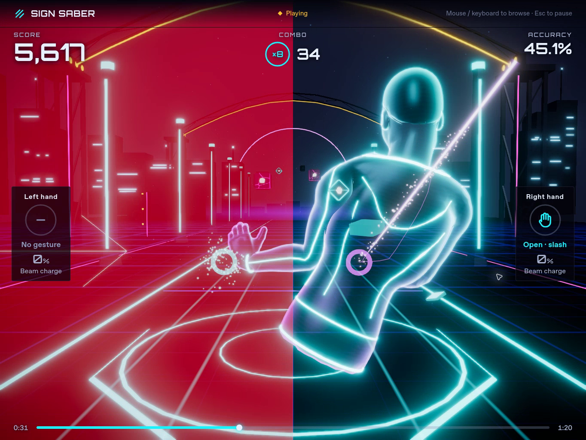
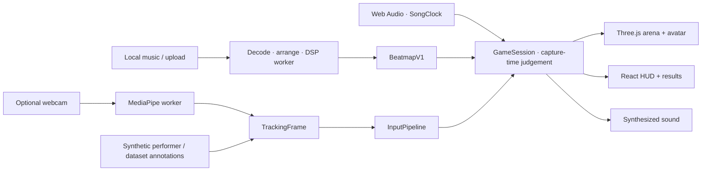

<div align="center">

# Sign Saber

### Upper-body rhythm combat, played in your browser.

Slice cyan blocks. Shatter magenta cubes. Charge gold beams. Lean clear of the next wall.

[](https://github.com/JunaidAhamed-7777/sign-saber/actions/workflows/ci.yml)
[](LICENSE)
[](app/package.json)
[](app/src/render/renderer.ts)
[](app/src/tracking/tracking.worker.ts)


**8 local songs · 3 difficulties · Custom audio · 28 original sound effects**

[Get started](#quick-start) · [Gameplay](#inside-the-arena) · [Camera play](#play-with-your-camera) · [Engineering](#how-it-works) · [Status](#project-status)

</div>

Sign Saber puts a holographic upper-body avatar in the middle of a neon rhythm arena. Sweep through approaching targets, hold a point to release a beam, and move your torso out of a wall's path. Cuts split along your swing; impacts scatter fractured pieces; each hit feeds the sound, score and combo.

Pick a bundled song or bring your own audio. The game finds an energy-rich section, builds an 80-second arrangement and generates a chart from the edited sound. Music analysis, rendering and optional webcam tracking run locally in the browser.

**Try it without a camera:** Watch auto-play sends a synthetic performer's movements through the actual input and scoring system. The footage here is captured from the running game, not a mock-up or a live-webcam demonstration. [Capture details and reproduction](docs/media/README.md).

## Inside the arena

<table>
  <tr>
    <td width="50%"></td>
    <td width="50%"></td>
  </tr>
  <tr>
    <td><strong>Follow through on the hit.</strong><br>Cyan targets split into capped halves along the swing plane. Magenta targets break into authored fracture pieces.</td>
    <td><strong>Hold for the beam.</strong><br>A tracked point builds charge, auto-aims at the next available gold orb and releases into an orb-collapse effect.</td>
  </tr>
</table>



Blade ribbons, sparks, reactive lighting and synthesized impacts surround a skinned, 43-bone avatar. The figure stays visible from head to hips, with controls at the sides rather than over the player. **Calm visuals** reduces decorative motion and reactive intensity while keeping the same game rules.

| Move | What happens |
| --- | --- |
| Sweep a moving hand through cyan | Slice the block and leave a blade trail with an open palm |
| Strike magenta | Shatter the block with a distinct impact sound |
| Point and hold | Charge for 500 ms, then automatically fire at an available gold target |
| Lean away from a wall | Dodge with your torso; contact costs up to 100 points without ending the run or breaking combo |

The current contact mode is forgiving: slash and smash accept **any hand shape moving at least 0.3 m/s**, with contact zones scaled to **2.5×** the visible block/palm footprint. Open-palm and fist visuals still distinguish the intended moves. Difficulty changes note density and approach time, not the timing windows. [Full gesture and scoring guide](docs/player-guide.md#moves-and-judgements).

## Choose your soundtrack


Eight full-length Kevin MacLeod tracks ship with the game, each with Easy, Normal and Hard charts. Preview before you start, page through the library, or choose your own MP3, WAV, OGG or M4A.

Starting a no-camera trial prepares a **10-second fade-in → 60-second highlight → 10-second fade-out** and generates a fresh chart against those exact samples. The highlight is selected using energy and onsets, not claimed chorus recognition. Short files get proportionally shorter sections; the original song remains available.

The two camera-free modes serve different purposes:

- **Watch auto-play** performs chart-planned motion through the input pipeline and contact judge. Hits, misses and results are earned by that synthetic input.
- **Play level** uses attributed COCO still-pose annotations. It has no recorded motion or hand-gesture labels, so missing gesture input produces real misses. Use it to inspect a level, not to assess tracking accuracy.


Results retain the run's score, accuracy, best combo and judgement breakdown. **Play again** restarts; **Songs** takes you back to the library.

## Quick start

Use **Node.js 22+** and current desktop Chrome or Edge with WebGL2 and hardware acceleration. Auto-play needs no webcam, account or tracking-model download.

```sh
git clone https://github.com/JunaidAhamed-7777/sign-saber.git
cd sign-saber/app
npm ci
npm run dev
```

Open [localhost:5173](http://localhost:5173):

1. Choose a song and **Easy**, **Normal** or **Hard**.
2. Click **Enable sound** with your mouse or keyboard. **Preview** lets you listen first.
3. Choose **Watch auto-play** to see a complete performance.
4. Press **Esc / Space** to pause, then **Resume** or **Quit to music**.

For a production build, run `npm run build`, then `npm run preview` inside `app/` and open [127.0.0.1:4173](http://127.0.0.1:4173).

<details>
<summary><strong>Controls, custom audio and recovery</strong></summary>

- **Menus:** mouse, Tab and Enter work throughout. Calibrated hand navigation uses an open palm to move and a deliberate point to confirm. Browser permission, sound activation and file selection still need native input.
- **Your music:** page the library to **Choose your own audio**. Supported files are 5 seconds to 5 minutes, up to 60 MiB; browser decoding and decoded-memory limits also apply. Analysis and chart generation stay local.
- **No sound:** choose **Enable sound** again and check Settings volume.
- **Track failure:** use **Retry track** or select another song. Invalid audio does not lock the library.
- **Storage unavailable:** generated music remains playable with a not-saved warning.
- **Graphics context lost:** the run stops and offers Retry/reload recovery.

See the [player guide](docs/player-guide.md) and [troubleshooting](docs/troubleshooting.md) for the full flow and recovery messages.

</details>

## Play with your camera

Live gesture play is implemented but still experimental. Completed human webcam calibration, scored-hit and full gesture/menu trials remain open verification work; the auto-play footage does not establish webcam accuracy.

1. From `app/`, run `npm run models` once to download the pinned MediaPipe hand and pose models, then `npm run dev`. Rebuild if using production preview.
2. Choose a song, enable sound, then choose **Set up camera** and allow camera access.
3. Keep your head and shoulders clearly in view, with room for your hands and upper body. Hold steady until the framing checklist is ready; setup confirms automatically after sustained readiness.
4. Choose **Play with camera**, follow the pre-play guide and let the countdown finish.

A mirrored tracking window shows the camera, skeleton, hands, recognized gestures and inference diagnostics. Camera pixels stay on your machine. Keep your surroundings clear and stop if movement hurts.

The live path uses worker-based inference, slower target approach and enlarged contact zones to accommodate tracking delay. Displayed hands and the avatar smooth between samples; scoring uses captured input rather than predicted motion. These are implemented design choices, not measured frame-rate or latency guarantees.

## How it works



- **One scoring path.** Camera, synthetic performer and dataset inputs share the tracking contracts. Capture-time samples are consumed once against the audio clock; visual extrapolation cannot create a hit. `game/` stays independent of Three.js.
- **Charts from sound.** Worker-side analysis resamples audio, measures spectral flux, estimates tempo and assigns gestures with reach and recovery constraints. Edited audio and its generated chart share a time base. Bundled audio and maps carry integrity hashes.
- **Bounded rendering and tracking.** Application-owned hot-path buffers and effects are pooled. Camera inference bounds work in flight; resources are released on teardown. The renderer uses authored Blender geometry, skinned-avatar retargeting and procedural fallbacks.
- **Local by design.** Music decoding, analysis and optional camera inference run on-device. The runtime tracker is MediaPipe; the separate `training/` research model is not used by the game.

The app uses **TypeScript, React, Zustand and Vite**, with **Three.js, WebGL and postprocessing** for the arena, **Web Audio** for playback and synthesized SFX, and **MediaPipe Tasks Vision** for optional tracking.

## Project status

The browser game includes the eight-song library, 24 bundled charts, generated arrangements, all four mechanics, auto-play, pause/retry, results, authored assets and optional camera setup. It remains an **experimental desktop game**, with live-human validation and release testing still in progress.

The merged build passed **574 automated tests** plus typecheck, lint, production build and bundle limits on 2026-10-26. Its full-chart replay suite registered **4,447 synthetic hits across 24 charts with zero misses**. The fresh browser footage shows a separate 80-second run with **84 hits and zero misses**. [Source revision, capture details and results](docs/media/README.md).

Remaining work includes consenting-person camera trials, independent chart-quality and comfort review, accessibility/flashing review, and repeatable performance and soak measurements. No measured FPS or motion-to-photon latency is claimed. [ROADMAP.md](ROADMAP.md) tracks acceptance criteria and [HANDOFF.md](HANDOFF.md) records implementation context.

## Development and verification

From `app/`:

```sh
npm run check
```

Runs typecheck, lint, tests, production build and the JavaScript bundle-budget check.

From the repository root:

```sh
node --test scripts/check-docs.test.mjs
node scripts/check-docs.mjs
node scripts/chart-report.mjs
node scripts/render-sfx.mjs --check
```

`npm run beatmaps` in `app/` regenerates bundled charts and requires ffmpeg. `npm run music`, `npm run fonts` and `npm run models` verify or acquire their respective assets. The [script guide](scripts/README.md) documents prerequisites and browser capture tools.

For code navigation, start with the [contributor guide](docs/contributor-guide.md), [architecture](docs/02-architecture.md), [design context](DESIGN.md) and [working agreement](AGENTS.md). The [specification index](docs/README.md) covers individual systems. Change history and AI-assisted contributions are retained in [CHANGELOG.md](CHANGELOG.md) and [AI_USAGE.md](AI_USAGE.md).

## Credits and licenses

**Created by Junaid Ahamed.** Code, original geometry and synthesized SFX use the [MIT license](LICENSE). The 28 sound effects are generated from original code without third-party recordings; [recipes and measured receipts](assets-src/audio/sfx-receipt.json) are included.

**Music:** “Pamgaea”, “Electro Cabello”, “Cipher”, “Chipper Doodle v2”, “Funkorama”, “Cut and Run”, “Rhinoceros” and “Marty Gots a Plan” by Kevin MacLeod ([incompetech.com](https://incompetech.com/)), licensed under [CC BY 4.0](https://creativecommons.org/licenses/by/4.0/). Bundled MP3s are unchanged; in-app arrangements select an excerpt and apply fades. GIFs are silent. [Per-track credits, sources and changes](app/public/assets/tracks/README.md).

**Fonts:** Orbitron and Rajdhani, [SIL OFL 1.1 with retained notices](app/public/assets/fonts/README.md).

**Data and models:** [COCO annotation attribution](app/public/assets/fixtures/ATTRIBUTION.txt), [research dataset rights](training/DATASETS.json) and [MediaPipe preparation](app/public/models/README.md). Raw research photos and weights remain local/ignored. Dependencies retain their own licenses and bundled notices.

Built on [Three.js](https://github.com/mrdoob/three.js), [React](https://github.com/facebook/react), [Zustand](https://github.com/pmndrs/zustand), [Vite](https://github.com/vitejs/vite), [postprocessing](https://github.com/pmndrs/postprocessing) and [MediaPipe](https://github.com/google-ai-edge/mediapipe).
