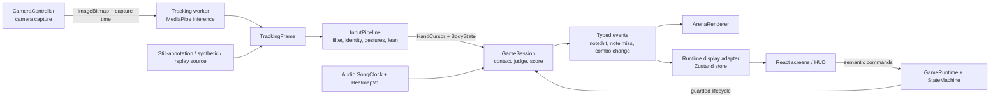

# Contribute to Sign Saber

Start with [AGENTS.md](../AGENTS.md), [the roadmap](../ROADMAP.md), [the documentation index](README.md) and [HANDOFF.md](../HANDOFF.md), then read the numbered specs for your change. The repository contains an experimental game with open live-camera and release gates. Implemented code, a passing build and actual hardware evidence are different claims.

## Find the code

- `app/src/core/`: shared types/constants/events, clocks, state machine and `GameRuntime`, the lifecycle integrator.
- `app/src/tracking/` and `gestures/`: bounded camera/worker exchange, upper-body filtering, `InputPipeline`, gestures, cursors, lean and menu pointing.
- `app/src/game/`: framework-free contact tests, judgement, score, spawning and `GameSession`. It must remain independent of Three.js.
- `app/src/audio/` and `beatmap/`: playback/clock, decode/arrangements, DSP worker, validation, local catalog and optional chart cache.
- `app/src/render/`: Three.js arena, owned snapshots, pooled geometry/effects and fixed cosmetic tiers. `app/src/ui/`, `App.tsx` and `state/` supply React screens and display state.
- `app/src/performer/`: planned synthetic motion behind **Watch auto-play**. `tracking/datasetTrial.ts` supplies the still-annotation **Play level** trial; diagnostic exports distinguish their input sources.
- `app/tests/`: asserted unit, interface and integration suites, plus browser numeric audio entries. `app/public/` contains packaged local music/maps, fonts, fixtures and models/assets.
- `scripts/`: plain Node preparation, integrity, serving and numeric browser checks. `assets-src/` holds authored asset sources; `training/` is separate research, not a production tracker.
- `docs/`: contracts, QA and retained evidence. [DESIGN.md](../DESIGN.md), [14](14-ui-ux.md) and [25](25-menu-and-hand-navigation.md) own UI direction/behavior.
- `server/`: optional companion-service scaffold; it is outside the core path and has no advertised working companion command.

## Follow the data



The diagram describes implemented boundaries; it does not imply that the live lane has passed human QA. `core/runtime.ts` accepts frames in `tracking`, passes the processed inputs to the session, and copies display data into the store. Renderer/UI consume game outcomes; they do not mutate game state. Mouse, keyboard and hand menu actions resolve through the same semantic target registry and state-machine guards.

For interface work, extend the shared owners in `ui/components/MenuShell.tsx`: `Button` registers semantic actions, `RailPager` owns menu paging and `Figure` reserves the central stage. `ControlIcon` supplies thin-stroke interface symbols; `GestureIcon` owns gesture symbols. `CoverArt` turns local track metadata into deterministic geometric sleeves without external images. `ui/theme.css` adapts the palette and type roles in [DESIGN.md](../DESIGN.md). Preserve those owners across selection, setup, pause and results instead of introducing screen-local controls. The [frontend browser receipt](evidence/2026-10-25-frontend-polish.json) records native action, viewport and failure-recovery checks for the refined menu.

Score unique capture-time samples exactly once. Render prediction cannot change scoring. Reject stale or old-session work and keep one frame in flight rather than growing the camera queue. Transferable buffers have explicit owners; consumers copy what they retain, and image bitmaps, model results and GPU resources must be released. Browser/MediaPipe allocations are measured boundaries, not a zero-allocation promise. The contracts and frame order are in [02](02-architecture.md#contracts), [05](05-tracking-pipeline.md) and [07](07-hit-detection-and-scoring.md).

## Set up and run checks

Use current Node 22 (CI baseline). From the repository root, run `cd app` and `npm ci`, then `npm run dev`. See the [Player guide](player-guide.md) for the actual app flow and optional local model preparation. Keep the lockfile; do not upgrade packages for an unrelated fix.

Run before every application milestone, from `app/`:

```powershell
npm run check
```

This runs `typecheck`, `lint`, `test`, `build` and `bundle:check` in sequence. The final step validates the emitted JavaScript chunks. Vitest runs asserted suites without a no-tests-success flag; keep meaningful assertions as implementation changes. For focused development, each is also a real command: `npm run typecheck`, `npm run lint`, `npm run test`, `npm run test:watch`, `npm run build`. `npm run format:check` checks source formatting. Avoid mass formatting generated/hash-pinned assets; regenerate them instead.

For documentation changes, run from the root:

```powershell
node --test scripts/check-docs.test.mjs
node scripts/check-docs.mjs
```

The checker verifies local Markdown paths/headings, not remote URLs, screenshots, runtime claims or hardware evidence. Match extra checks to the changed boundary:

- Prepared HTTP/CSP/range serving: `node --test scripts/serve.test.mjs`.
- Authored model-asset integrity: `node --test scripts/check-model-assets.test.mjs` and `node scripts/check-model-assets.mjs`.
- Bundled chart diagnostics: `node scripts/chart-report.mjs` prints note/gesture mix, density, simultaneous on-screen load and the synthetic performer's unreachable count for all installed charts. It reads assets without regenerating them; performer reachability is not human comfort or music-quality acceptance.
- Production browser recovery and clean setup: `node scripts/lifecycle-qa.mjs` exercises eight failure/lifecycle scenarios and resource cycles; `node scripts/release-drill.mjs` exercises a clean-commit installation and offline browser journey. Their reports retain the tested source/environment and failures. See the [script guide](../scripts/README.md) and [QA protocol](17-testing-and-qa.md) before running these longer checks.
- Audio numeric correctness in Chrome: `node scripts/check-audio-resampling.mjs`; add `--arrangement` for edited-audio checks. These require Chrome (or `BROWSER_BINARY`) and ffmpeg. They do not measure audible synchronization, live tracking or physical latency.
- Tracking worker/model startup: after `npm run models` and `npm run build` in `app/`, run `node scripts/check-tracking-init.mjs` from the root (`--cpu` requests the CPU delegate). It submits three synthetic blank images, with no webcam/human throughput claim.
- Developer dataset-camera preparation helpers: `node --test scripts/prepare-dataset-camera.test.mjs`. The [preparation script](../scripts/prepare-dataset-camera.mjs) and [browser trial](../scripts/dataset-camera-trial.mjs) document their real commands/prerequisites: acquired licensed COCO data, ffmpeg/ffprobe, Chrome and prepared tracking models. Their still-photo inference lane is separate from the menu's annotation trial and from a live person.
- Bundled chart changes: `npm run beatmaps` from `app/` regenerates/validates charts with shared DSP and canonical ffmpeg/ffprobe decoding. Keep audio, generation receipts and manifest hashes consistent. `npm run music`, `npm run fonts` and `npm run models` are explicit asset-preparation commands, with network needed when downloading.

CI currently runs Node 22 application typecheck/lint/tests/build plus the two root documentation checks. A green CI job does not replace the [manual QA](17-testing-and-qa.md#4-manual-qa-checklist), [clean-clone/release checklist](19-build-plan.md#release-checklist), offline exercise or [benchmark protocol](24-benchmark-and-evidence.md). Preserve failed outcomes as well as passes.

## Add or change a tunable

1. Find its owner in [02 → Constants](02-architecture.md#constants), or the explicit linked renderer/UI sub-registry. Reuse the existing name and units when one exists.
2. Add the documented value and its export in `app/src/core/constants.ts` together. Do not hide thresholds, limits or cosmetic budgets inside a consumer.
3. Update producers, consumers, the owning spec and meaningful behavior tests together. Keep normative names such as `TrackingFrame`, `HandCursor`, `note:hit` and `WINDOW_PERFECT_MS` verbatim.
4. Run the affected tests and required checks. Record behavior/reason/limitations in `CHANGELOG.md`; an unmeasured default is not a proven performance improvement.

## Keep evidence lanes separate

- **Live:** actual consenting person, webcam pixels and inference. Record device/browser/environment and what was observed. A GPU preview alone is not calibrated gameplay or a scored live hit.
- **Dataset:** independent attributed COCO still annotations. No temporal hand labels, masks or physical movement are invented; missing gestures produce misses. The separate prepared-photo dataset-camera lane exercises inference, but is still not a live person or temporal motion dataset.
- **Synthetic performer:** chart-planned motion through `InputPipeline` and `GameSession`. Positive scores prove those synthetic inputs exercised scoring; they say nothing about recognition accuracy.
- **Logic replay:** deterministic fixtures/timestamps used to compare judgement sequences and totals, including alternate render cadences and late packets. Mark synthetic versus consented-recording provenance. Replay is never a substitute for a live-camera benchmark.

Screenshots, numeric audio probes, model parity and performance runs each need their own scope too. Save actual date/SHA/environment/source, inputs and failures; never copy a target budget into a measured-results field. Raw camera recording is local, explicit and opt-in; do not commit private recordings, participant details, credentials, datasets or research checkpoints.

## Make a reviewable change

Inspect `git status`, fetch/pull current main and check the issue's body/comments and existing PRs before editing. Coordinate temporary file boundaries with concurrent contributors. Preserve useful existing work and integrate new remote commits normally; no force-pushes, backdating or shared-history rewrites. Use a focused `junaid/` branch for an issue PR and keep its changes within the requested scope.

Complete and validate a coherent step, stage only finished work and commit small milestones (roughly every 20–30 minutes in sustained work, and at roadmap gates). Use a short descriptive message such as `feat(judge): finalize misses after capture watermark`; use an honest `wip:` before handing off incomplete work. Do not add `Co-Authored-By:` or AI attribution trailers.

In every meaningful commit, prepend a real timestamp with timezone to `CHANGELOG.md` and record changed files/behavior, why, checks actually run and limits. Keep history intact; correct an old claim in a new entry. Add a brief meaningful AI-contribution summary to `AI_USAGE.md`, and update README when commands, setup, status or behavior change. Push when authorized, and explain the issue trigger, resulting behavior and actual validation in the PR. Do not declare a roadmap gate or release complete while required evidence is missing.
