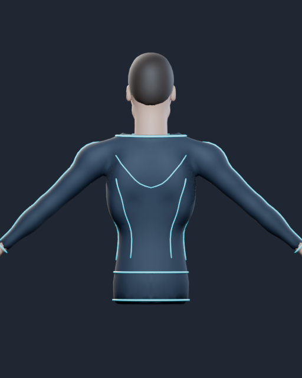
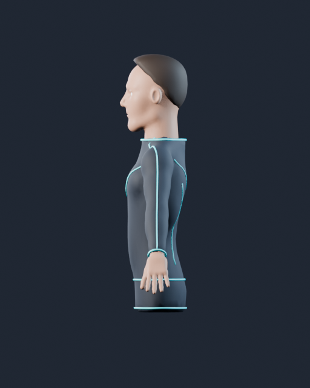
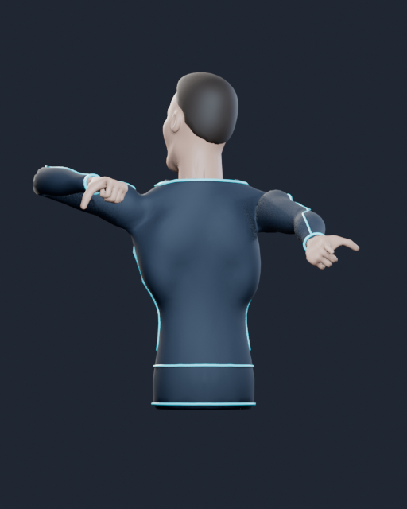

# Cloud avatar refinement — 2026-10-25

## Scope and authoring

This is a focused asset/motion checkpoint, not a new release or live-camera acceptance result. The rear-facing upper-body avatar retains its original anatomy, 43-bone hierarchy, rest landmark anchors, five material slots and no-leg scope. Scoring and capture-time inputs are unchanged.

- Motion: placement now uses the smoothed rendered shoulder/clavicle transforms rather than the unsmoothed IK target. Lean and tracking-loss regressions reproduce the old mismatch and pass with the correction; compound head pitch/yaw/roll remain tested without a speculative basis rewrite.
- Asset: fine rear shoulder-yoke and waist-contour seams; suit surface budget raised from 4,300 to 4,600 pre-cleanup triangles and tangential relaxation/reprojection raised from four to eight rounds for the suit only.
- Mesh validation removes two invalid suit faces before weighting (4,600 → 4,598 faces/triangles in the triangulated suit; vertex count stays 2,302), verifies the repaired mesh, and refuses unexpected joined-mesh repair. The final exporter emits no invalid-mesh warning.

Authoring used **Blender 4.3.2** in a dedicated cloud GUI scene and actual `execute_code` requests through the official pinned Blender MCP add-on's loopback JSON/TCP bridge. The add-on commit/hash are preserved in the [avatar manifest](../../app/public/assets/models/avatar-manifest.json). The initial read-only scene request and actual baseline/final renders succeeded. Optional external asset services and automatic update callbacks were disabled. No third-party assets or user recordings were used.

The older Blender 5.2 source could not be opened directly by 4.3.2. A fresh isolated source was regenerated from the maintained generator; the old shipped GLB served as the visual/rig reference. Other arena/target assets were not regenerated or reattributed.

## Artifact and structural validation

- Final avatar: **15,820 triangles**, **7,941 vertices**, **529,672 bytes** (16,000-triangle limit).
- SHA-256: `68d8ef98ac7db0963e505e1cc216a9688bdd2319eed1d8b6ec97f50eeed46304`.
- [Binary validation](cloud-avatar-polish/binary-validation.json): no degenerate exported triangles, finite buffers, valid indices, normalized skin weights and matching source/export hashes.
- [Application-loader/CPU skin validation](cloud-avatar-polish/rig-validation.json): 43 bones, 21 exported anchors, five material slots, unchanged reference rest transforms/anchors, valid inverse binds, and maximum rest-bind drift below 0.000001 m.
- All 21 avatar loader/retarget tests were exercised against the exact final staged bytes before integration. Twelve acceptance/corruption checks cover the new reusable avatar gate; five offline mocked tests cover bootstrap safety. CI now enforces these additional gates.
- [Khronos glTF Validator](cloud-avatar-polish/khronos.json): **zero errors, one warning**. `NODE_SKINNED_MESH_NON_ROOT` is also present in the original asset; the identity armature-parent and CPU bind invariants are explicitly checked. This is not a zero-warning claim.

## Actual rendered comparison

These are Blender EEVEE asset previews, **not gameplay screenshots or live-camera evidence**. The final back, side and stress poses use 512 × 640 output with 16 render samples. The original and refined stress poses use the same pose, camera and light setup.

Visual inspection found that the new rear seams remain attached during the compared pose. The shoulder-cap/elbow folds visible at this extreme pose also exist in the original; this pass does not claim perfect deformation or eliminate those folds.

## Verification limits

Repeated exports were structurally valid but did not have identical GLB byte hashes. A read-only comparison of the two saved meshes found identical vertex coordinates, skin weights, rotation-normalized oriented face connectivity, face/material assignments and triangulated connectivity, but different raw polygon storage order ([comparison](cloud-avatar-polish/repeat-build.json)). The current manifest records the actual final artifact and source hashes; no byte-identical regeneration guarantee is made.

Application typecheck, lint, tests, production build, bundle budgets and formatting are recorded in the matching changelog checkpoint. The unchanged seven-file arena pack also passed its existing structural checks. Cloud Blender rendering and automated rig tests do not replace browser/gameplay, human comfort, performance or live-camera checks. The cloud browser could not reach the isolated development server, so no new runtime-browser appearance result is claimed.
