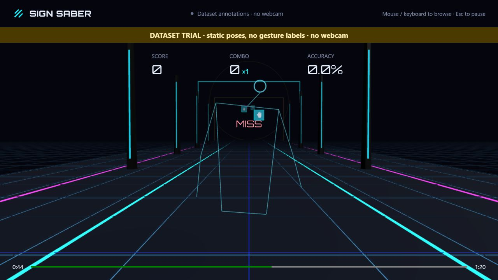
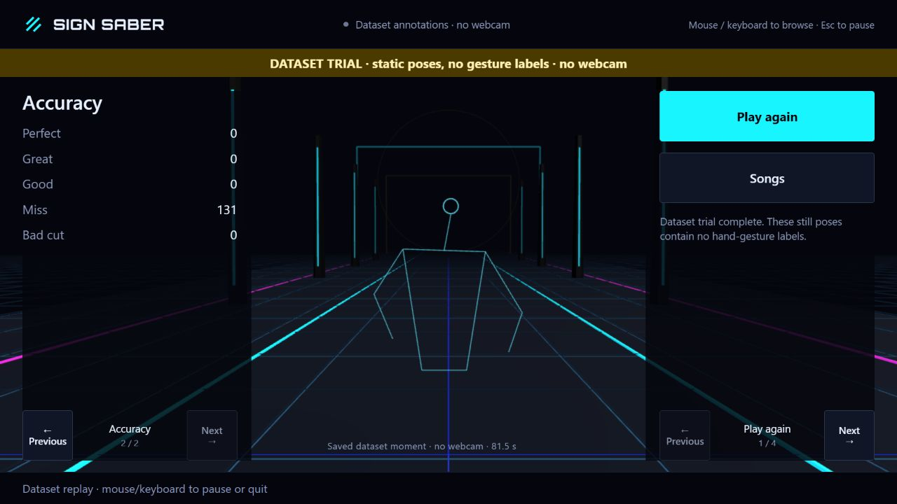
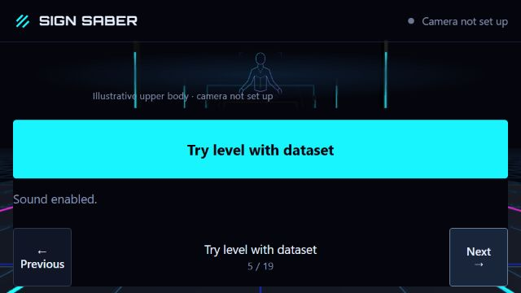

# Initial dataset level smoke — 2026-10-25

This is an informal browser workflow observation, not a P4 benchmark or P5 release claim. The in-app Chromium browser served the prepared local build at 1280×720 CSS pixels. The exact loaded entry was `/assets/index-PeSL7hbM.js`; it came from the working tree before the app integration checkpoint, with no complete benchmark run manifest.

The menu opened without camera setup. Selecting Pamgaea and enabling sound loaded the full local song. **Make 80-second cut** rendered the actual derivative WAV and generated a new Normal map: 80 seconds, 131 notes. **Try level with dataset** counted in, ran through the song/tail and reached actual results. Eight independent attributed COCO still annotations supplied only head/arm/hip positions; no temporal recording, fingers, gesture labels, metric depth or masks were invented. Results showed 0 Perfect, 0 Great, 0 Good, 131 Miss and 0 Bad Cut, with zero score/accuracy. This is the expected missing-gesture outcome, not a claim of successful gesture play. The saved dataset pose was owned and labelled at 81.5 s. Native results pagination worked.

Annotation provenance/rights: [local attribution](../../app/public/assets/fixtures/ATTRIBUTION.txt), [exact fixture](../../app/public/assets/fixtures/coco-upper-body-trial.json). Source photo pixels were not displayed or redistributed. The Blender arena and game UI are original repository assets.

Live webcam correctness, audible synchronization, musical highlight preference, frame/GPU metrics, human comfort and complete offline/failure drills remain unverified. Later renderer/head-marker, guard and auto-arrangement changes require their own source checks; this screenshot is retained as the initial completed trial rather than retroactively described as the final build.

## Automatic arrangement and recovery follow-up

A later prepared local build loaded `/assets/index-VQiI7aKP.js` at 1280×720 CSS pixels. It included the dataset Resume and canonical fixture checksum fixes before their `08d7555` checkpoint; it was a working-tree smoke test, not an exact-commit benchmark. Native selection of Pamgaea, **Enable sound**, then **Try level with dataset** automatically created the 80-second derivative and fresh 131-note Normal map, ran without webcam permission, and reached actual results. A second run paused via Escape at about 20.9 seconds. The corrected Resume button was enabled without calibration, showed the guarded countdown, resumed and completed with the same zero hits / 131 Miss outcome. On Results, Return started a new dataset countdown with camera still unset; Escape then Quit returned to usable browsing. No gesture or trained-tracker success is inferred.

At a forced 640×360 CSS viewport, the compact single-action pages exposed Pamgaea, Electro Cabello, Cipher, native Enable sound and Try level with dataset in order. DOM bounds recorded a 608×83.4 px song target and 72×72 px Previous/Next targets fully inside the viewport. This verifies that exercised compact path only; it is not a mobile, browser-zoom, screen-reader or standing-hand reach claim. The screenshot backend's scaled composition is retained as captured rather than edited.

The clean-clone integrity failure and corrected Node22 check are separately recorded in [clean-clone evidence](2026-10-25-clean-clone.md). These observations do not complete the human, live-camera, music-quality or performance gates.
