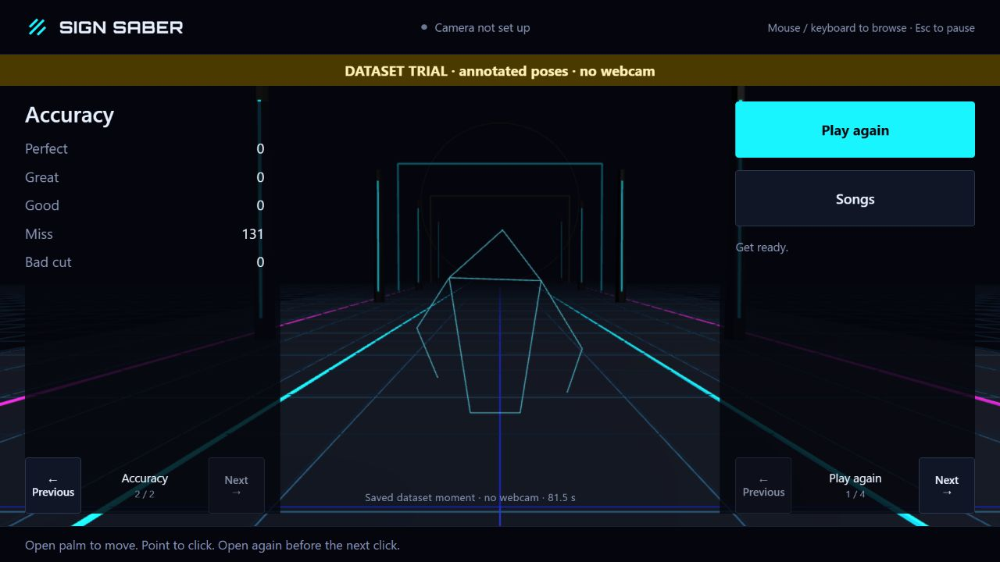

# Initial dataset level smoke — 2026-10-25

This is an informal browser workflow observation, not a P4 benchmark or P5 release claim. The in-app Chromium browser served the prepared local build at 1280×720 CSS pixels. The exact loaded entry was `/assets/index-PeSL7hbM.js`; it came from the working tree before the app integration checkpoint, with no complete benchmark run manifest.

The menu opened without camera setup. Selecting Pamgaea and enabling sound loaded the full local song. **Make 80-second cut** rendered the actual derivative WAV and generated a new Normal map: 80 seconds, 131 notes. **Try level with dataset** counted in, ran through the song/tail and reached actual results. Eight independent attributed COCO still annotations supplied only head/arm/hip positions; no temporal recording, fingers, gesture labels, metric depth or masks were invented. Results showed 0 Perfect, 0 Great, 0 Good, 131 Miss and 0 Bad Cut, with zero score/accuracy. This is the expected missing-gesture outcome, not a claim of successful gesture play. The saved dataset pose was owned and labelled at 81.5 s. Native results pagination worked.

Annotation provenance/rights: [local attribution](../../app/public/assets/fixtures/ATTRIBUTION.txt), [exact fixture](../../app/public/assets/fixtures/coco-upper-body-trial.json). Source photo pixels were not displayed or redistributed. The Blender arena and game UI are original repository assets.

Live webcam correctness, audible synchronization, musical highlight preference, frame/GPU metrics, human comfort and complete offline/failure drills remain unverified. Later renderer/head-marker, guard and auto-arrangement changes require their own source checks; this screenshot is retained as the initial completed trial rather than retroactively described as the final build.
