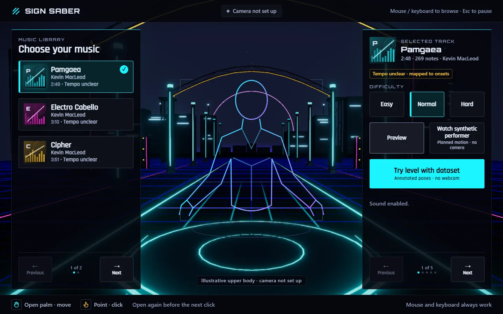
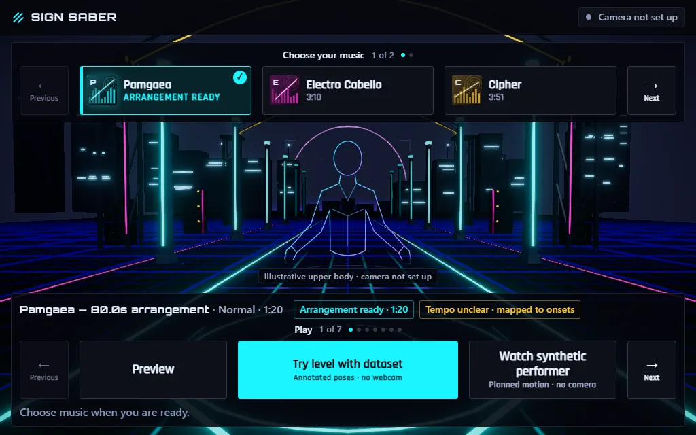
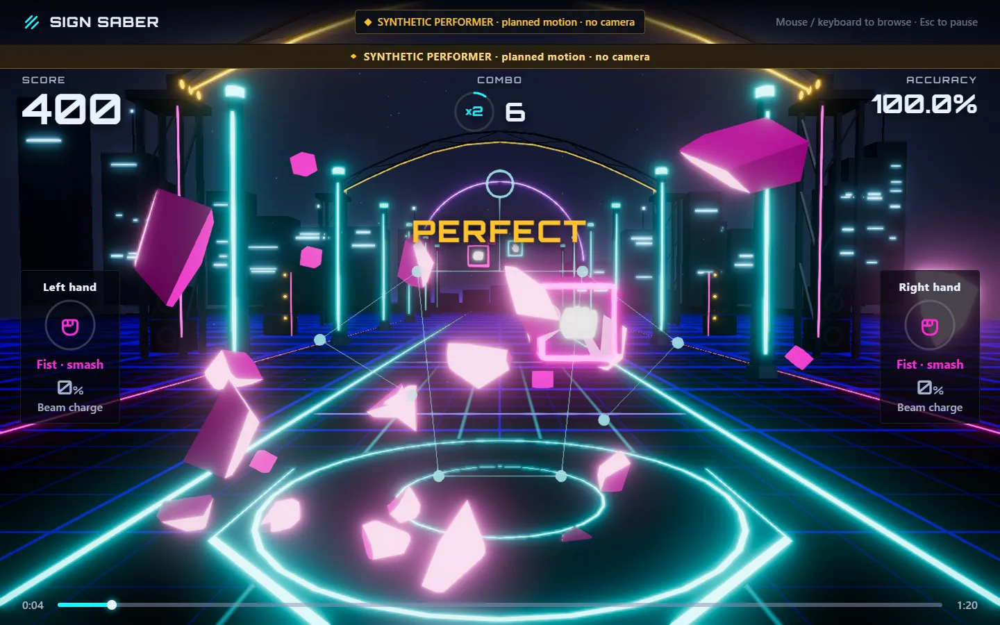
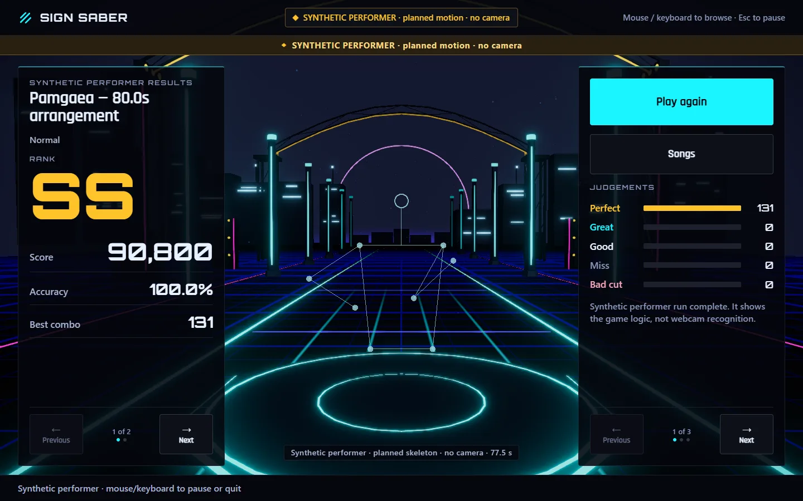

# Play Sign Saber

Sign Saber is an experimental desktop rhythm game: cut blocks with open hands, smash with fists, hold a point for beams and lean away from walls. Your figure stops at the hips. You can browse music and try the game without a camera.

Live gesture play is implemented, but a completed consenting-person calibration and a verified live scored hit are still open release checks. The no-camera trials below let you see the current game without implying that those checks have passed.

## Start the app

Use a current Node 22 release, the project's CI baseline. In a terminal at the repository root:

```powershell
cd app
npm ci
npm run dev
```

Open [localhost:5173](http://localhost:5173) in current desktop Chrome or Edge with WebGL2 and hardware acceleration enabled. The menu needs no account, camera permission or model download. Keep the terminal open while playing.

For a prepared production build, run `npm run build`, then `npm run preview` from `app/` and open [127.0.0.1:4173](http://127.0.0.1:4173).

## First try, without a camera

1. Choose a song card in **Choose your music**. Wait for its duration and note count to appear in **Selected track**.
2. Choose **Easy**, **Normal** or **Hard**. Easy gives more approach time and fewer notes; Hard gives less approach time and denser patterns. The timing judgement windows stay the same.
3. Choose **Enable sound** with your mouse or keyboard. A hand gesture cannot unlock browser audio. **Preview** then lets you listen before starting; **Stop preview** stops it.
4. Choose **Watch synthetic performer** to watch planned motion hit notes, or **Try level with dataset** to inspect the level with annotated still poses. Both show their input source throughout the run.
5. After the pre-roll, the level plays to real results. **Play again** retries; **Songs** returns to music selection.



Desktop menu after choosing music and enabling sound (1440 × 900).

The library and action rails have **Previous / Next** pages. On compact windows they move above and below the figure; look for the **Play** and **Difficulty** pages. Mouse and keyboard remain available throughout: Tab moves focus, Enter/Space activates a focused button, and Esc or Space pauses during play. Choose **Resume** to continue or **Quit to music** to leave. Hiding the tab pauses play; returning does not resume it automatically.



Compact menu after returning from a trial; the prepared arrangement remains selected (1024 × 640).

### What the two trials show

**Watch synthetic performer** plans motion for the selected chart and sends synthetic landmarks through the real input and scoring path. Hits, combo and results come from that path. It shows game logic and rendering; it uses no person, camera pixels or recognition model.



A real synthetic-input run, with its source banner retained.

**Try level with dataset** displays independent COCO upper-body still annotations. These poses have no recorded motion or hand-gesture labels, so missing gesture input produces genuine misses. It shows audio, level rendering and lifecycle behavior. Its score cannot measure a player's skill or tracking accuracy.

Neither trial establishes webcam accuracy, real-world latency, human comfort or musical chart quality. The source-labelled motion proxy in results is also not a fitness or calorie measurement. See the [dataset attribution](../app/public/assets/fixtures/ATTRIBUTION.txt) and [evidence rules](24-benchmark-and-evidence.md). A separate developer dataset-camera path feeds prepared images through inference; it is distinct from the menu's still-annotation trial and is not needed for these steps.



Actual results from the Pamgaea Normal 80-second arrangement, labelled as a synthetic performer run.

## The 80-second cut and your own audio

The first launch of either no-camera trial prepares an edited song and generates a fresh chart from its exact audio. Page to **Make 80-second cut** to prepare it separately: 10 seconds fading in, a 60-second highlight and 10 seconds fading out. The highlight uses an energy/onset heuristic; it is not verified chorus detection. Short supported files use proportionally shorter sections. The full source song remains in the library; select its song card again to reload it.

Page through the music rail to **Choose your own audio** to select a local MP3, WAV, OGG or M4A. Files must be 5 seconds to 5 minutes and no larger than 60 MiB; browser decoding and the decoded-memory limit can reject a file within those limits. Analysis runs locally. **Cancel analysis** leaves the menu usable. **Tempo unclear · mapped to onsets** means the chart follows detected onsets instead of claiming a confident beat grid.

## Optional camera setup

Prepare the local tracking files once while online, from `app/`:

```powershell
npm run models
```

If using production preview, rebuild after downloading them. On the menu, page to **Settings → Camera & live play**, choose **Set up camera** with mouse or keyboard, and allow browser camera access. No song needs to be selected first.

Frame your head, shoulders, hands and hips in a clear, comfortable space. Hold still until both hands and the framing checklist are ready, then choose **Confirm camera & position**. Permission alone does not establish calibration. Choose music, enable sound and use **Start live play** on the camera/live-play page, then **Confirm ready** when the pre-play guide is ready. Cancel or Esc returns to music if setup cannot complete.

After tracking is ready, an open palm moves the menu pointer. Point deliberately to click once, then open your palm again before the next click. The permission dialog, sound enable and file picker still need mouse or keyboard.

## Moves and judgements

- **Open hand → slash.** Sweep through a slash block as it reaches the hit plane. A slow resting hand does not count as a cut.
- **Fist → smash.** Strike a smash block with a closed fist. A fast wrong gesture can cause **Bad cut**, worth zero points and breaking combo.
- **Point and hold → beam.** Aim your index fingertip at the beam target and hold the point to charge (500 ms at the current default). Full charge waits until an aimed target enters its eligible timing window; it does not fire merely because a distant target appears. Charge resets after a shot.
- **Lean → dodge.** Lean right for a wall on the left, and left for a wall on the right. Keep your torso visible. There is no leg, jumping or ducking requirement in the current core game.

Timing uses the captured input sample, not the displayed frame. At the current `WINDOW_SCALE = 1`, the absolute early/late error is **Perfect: up to 60 ms**, **Great: over 60 through 120 ms**, and **Good: over 120 through 200 ms**. A valid gesture/contact is still required. An unresolved note becomes **Miss** after its eligible window and bounded late-input allowance close. Difficulty changes chart density and approach time, not these windows. The [scoring specification](07-hit-detection-and-scoring.md#6-judgement) explains the rules.

The HUD shows score, combo, multiplier, accuracy, progress and each hand's gesture/beam charge. Missing hand data is labelled rather than replaced with pretend input. Results show judgement counts and best combo; accuracy is based on unmultiplied earned points, so it need not equal score divided by maximum score.

## Calm visuals and help

Page to **Settings → Sound & visuals** and toggle **Standard visuals** to **Calm visuals** for quieter visual effects. Calm reduces decorative motion and reactive intensity while retaining required cues and the same game rules. Your system's reduced-motion preference enables it and cannot be overridden by switching to Standard. Calm is not a claim that flashing, contrast or comfort acceptance has been completed.

For missing sound, unavailable tracks, camera errors or low frame rate, see [Troubleshooting](troubleshooting.md). Stop if movement hurts, and keep the space around you clear.

The screenshots were captured on 2026-10-25 from a production build of [main commit 52e9c81](https://github.com/JunaidAhamed-7777/sign-saber/commit/52e9c81) in headless Chrome 155.0.8059.86 on Windows, using SwiftShader with muted output. They are actual app captures encoded as WebP; they are not live-camera, audible-sync, accessibility or GPU-performance evidence.
